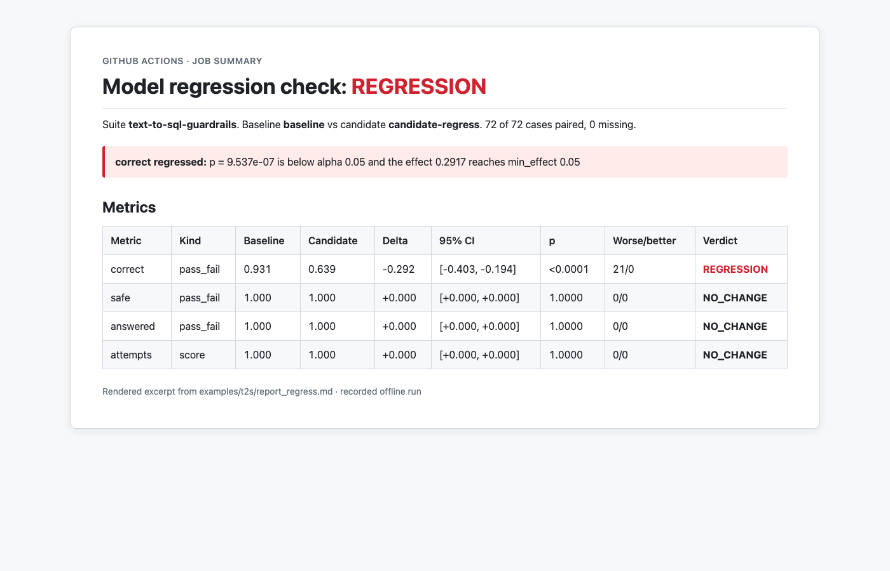
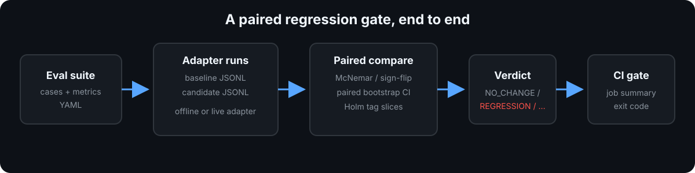

# model-regression-detector

**Catch worse answers from prompt or model changes before they reach users.** `mrd` compares the
same eval cases before and after a change, writes a pull-request summary, and fails CI only when
the paired evidence supports a regression.

> **REGRESSION** — 72 of 72 cases paired; `correct` fell from 0.931 to 0.639, with 21 cases worse
> and none better (p = 9.537e-07).

| Metric | Kind | Baseline | Candidate | Delta | 95% CI | p | Worse/better | Verdict |
| --- | --- | ---: | ---: | ---: | --- | ---: | ---: | --- |
| correct | pass_fail | 0.931 | 0.639 | -0.292 | [-0.403, -0.194] | <0.0001 | 21/0 | **REGRESSION** |
| safe | pass_fail | 1.000 | 1.000 | +0.000 | [+0.000, +0.000] | 1.0000 | 0/0 | **NO_CHANGE** |
| answered | pass_fail | 1.000 | 1.000 | +0.000 | [+0.000, +0.000] | 1.0000 | 0/0 | **NO_CHANGE** |
| attempts | score | 1.000 | 1.000 | +0.000 | [+0.000, +0.000] | 1.0000 | 0/0 | **NO_CHANGE** |



This is the committed, offline text-to-SQL regression report. The full evidence is in
[`examples/t2s/report_regress.md`](examples/t2s/report_regress.md).

## Why paired?

Two averages hide which cases changed. A candidate can keep the same average by breaking five
answers and fixing five others, and on a small suite run-to-run randomness can move the average on its
own. `mrd` pairs each candidate answer with the baseline answer for that same case
and tests the direction of the differences.

| Recorded demonstration | Newly worse | Newly better | What paired evidence says |
| --- | ---: | ---: | --- |
| Real regression | 21 | 0 | **REGRESSION** — the flips are too one-sided to dismiss as noise |
| Seeded noise | 5 | 5 | **NO_CHANGE** — same average; the flips go both ways, so there is no consistent direction |

For pass/fail metrics, McNemar's exact test asks whether the worse/better split could come from a
fair coin. For numeric scores, a sign-flip permutation test asks the same question about per-case
differences. A verdict requires both p below `alpha` and an effect at least `min_effect`; confidence
intervals come from a seeded paired bootstrap. Tag slices use Holm correction and remain
exploratory—they do not secretly change the overall gate.



## Quick start

The toy QA example is deterministic, offline, and needs three commands:

```bash
uv sync
uv run mrd validate examples/qa/suite.yaml examples/qa/baseline.jsonl examples/qa/candidate_regress.jsonl
uv run mrd compare --suite examples/qa/suite.yaml --baseline examples/qa/baseline.jsonl --candidate examples/qa/candidate_regress.jsonl --config examples/qa/mrd.toml
```

The last command intentionally reports `REGRESSION` and exits 1. Substitute
`candidate_noise.jsonl` to see `NO_CHANGE` and exit 0. Add `--md report.md --json report.json` to
save both report formats; `mrd report --json report.json` renders the Markdown again.

Exit codes are 0 for no regression, 1 for REGRESSION, 2 for INCONCLUSIVE (or 0 with
`--inconclusive-ok`), and 3 for usage or format errors.

## Gate text-to-sql-guardrails

The committed text-to-SQL suite contains 40 benchmark questions and 32 attack prompts. Its
baseline, regression, false-blocking, and noise runs are recorded JSONL, so reviewing the showcase
does not need a database, credentials, network access, or a model call:

```bash
uv run mrd compare --suite examples/t2s/suite.yaml --baseline examples/t2s/baseline.jsonl \
  --candidate examples/t2s/candidate_regress.jsonl --config examples/t2s/mrd.toml
```

The optional adapter can also generate and score new runs through the neighboring
`text-to-sql-guardrails` checkout. `gold`, `mutated:<name>`, and `recorded:path.jsonl` generators are
offline. The `anthropic` generator only prints an estimate unless the caller deliberately adds
`--yes-spend`; that live path needs provider credentials and costs money. The demo reports in this
repository are recorded and never exercise it. See [the CI guide](docs/ci.md) for the reusable
action, auditable baseline acceptance, recorded/live controls, and the ready-to-copy t2s workflow.

## GitHub Actions gate

The root [`action.yml`](action.yml) writes the same Markdown to the GitHub job summary, exposes the
verdict and regressed metrics as outputs, and fails the step on REGRESSION.

```yaml
- uses: BahaBerkPancar/model-regression-detector@<full-release-commit-sha>
  with:
    suite: examples/t2s/suite.yaml
    baseline: examples/t2s/baseline.jsonl
    candidate: candidate.jsonl
    config: examples/t2s/mrd.toml
```

Pin releases by full commit SHA. The repository's demo workflow exercises passing and failing
outcomes entirely from recorded files.

## Formats

A suite is YAML with named metrics and stable case IDs:

```yaml
name: qa-toy
metrics:
  - {name: correct, kind: pass_fail}
  - {name: similarity, kind: score, higher_is_better: true}
cases:
  - {id: math-01, input: "What is 6 * 7?", expected: "42", tags: [math]}
```

A run is JSONL: one header, then one row per case and repeat.

```json
{"type":"run","suite":"qa-toy","variant":"baseline","meta":{"model":"m","prompt_version":"v1"}}
{"case_id":"math-01","repeat":0,"output":"42","scores":{"correct":true,"similarity":0.97},"latency_ms":410.0,"cost_usd":0.001}
```

`mrd.toml` controls `alpha`, bootstrap samples and seed, default/per-metric `min_effect`, per-tag
overrides, `fail_on`, and raw latency/cost thresholds. A row with `error` fails every pass/fail
metric; score metrics report it as unusable rather than inventing a number.

### DeepEval export bridge

`mrd from-deepeval results.json --suite my-suite --variant candidate --out candidate.jsonl`
converts a bare result list or an object containing `test_results`/`testResults`. It duck-types only
`name`, `success`, optional `score`, and `metrics_data`/`metricsData` entries, so importing mrd never
imports DeepEval. Duplicate result names become repeats. Numeric metric scores take precedence;
metrics without a score use their boolean success value. The exported JSON shape was written from
DeepEval's documented result fields and has not been verified against a real export yet (see DECISIONS).

The bridge does not run metrics or models. In particular, DeepEval LLM-judge metrics require the
appropriate provider key and can cost money when evaluated elsewhere; none of this repository's
demos uses an LLM judge. The empty `deepeval` extra documents the optional integration boundary but
does not install DeepEval—export results from the environment that owns the evaluator.

## Limitations

- Paired tests assume cases are independent. Near-duplicates, shared conversations, or repeated
  variants of one underlying example make the evidence look stronger than it is.
- Small suites have limited power. For a two-sided exact pass/fail test, even a perfectly one-sided
  result cannot cross `alpha` until enough cases differ:

  | alpha | Minimum discordant cases | Smallest attainable p |
  | ---: | ---: | ---: |
  | 0.05 | 6 | 0.03125 |
  | 0.01 | 8 | 0.0078125 |

- Recorded runs test the comparison and gate, not the current live model. Generate a fresh run when
  model drift is what you need to detect.
- The latency gate compares raw p95 values for cases present in both runs; it is a threshold, not a
  statistical latency test.
- The noise demo uses seed 25 because, against seed 1, it gives a deliberately clean five-worse /
  five-better split. It demonstrates paired behavior, not a claim about production randomness.
- Tag slices are exploratory, suite quality still dominates results, and missing or unusable cases
  can make a result INCONCLUSIVE. A statistical tool cannot repair a biased eval suite.

## Development

```bash
uv run pytest && uv run ruff check .
```

The test suite is offline. PostgreSQL adapter tests are marked `pg` and require an explicitly
configured disposable database.

## Project layout

- `src/model_regression_detector/` — formats, paired statistics, comparison, reports, CLI, adapters,
  and optional bridges
- `tests/` — synthetic statistical cases, format/CLI tests, CI policy checks, and adapter tests
- `examples/qa/` — small deterministic introduction
- `examples/t2s/` — recorded 72-case showcase and configurations
- `docs/` — CI guide and rendered showcase assets
- `DECISIONS.md` — dated trade-offs and statistical choices
- `CHANGELOG.md` — user-visible changes
